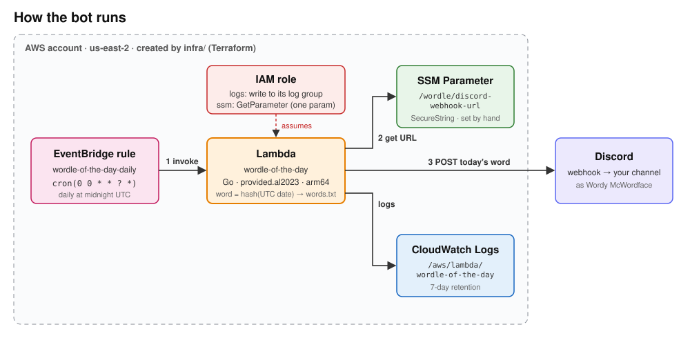
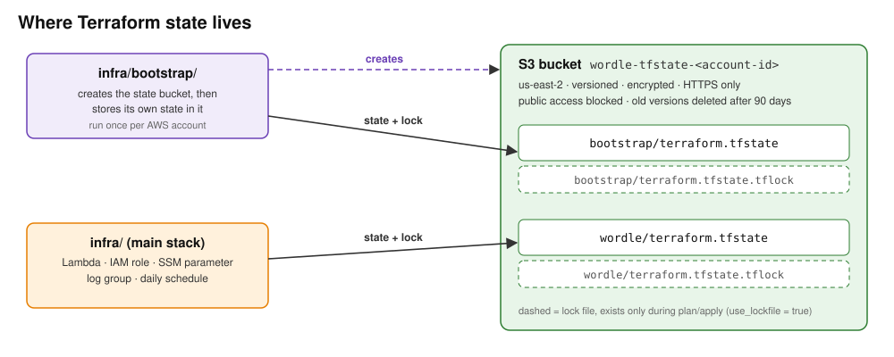

# Wordle Word of the Day

A small Go bot that posts a starting word for Wordle to a Discord channel every day at midnight UTC.

It runs as an AWS Lambda function on a daily schedule and posts as **Wordy McWordface**:

> The starting word of the day is: **FRITS**. Or don't. I'm a bot, I can't make you.

The word depends only on the UTC date, so every run on the same day posts the same word, including retries and manual test runs.

## How it works



1. An EventBridge rule invokes the Lambda every day at **00:00 UTC** (`cron(0 0 * * ? *)`).
2. The Lambda reads the Discord webhook URL from SSM Parameter Store, decrypting the SecureString.
3. It picks the word for today's UTC date and POSTs it to the webhook. The date (e.g. `2026-11-24`) is hashed with FNV-1a to choose a word from `words.txt`, which is built into the binary.

The Lambda's IAM role can only write to its own log group and read that one parameter. Logs go to `/aws/lambda/wordle-of-the-day`, kept for 7 days.

Everything runs in **us-east-2**. The AWS organization's service control policy only allows global services (IAM, STS, KMS, CloudWatch Logs and similar) in us-east-1, and blocks other regions, so regional resources like S3, Lambda, SSM and EventBridge must be in us-east-2.

## Project layout

| Path | What it is |
|---|---|
| `main.go` | The bot. Runs as a Lambda handler on AWS, or once locally. |
| `main_test.go` | Unit tests. Discord and SSM are faked locally; no AWS access needed. |
| `words.txt` | One 5-letter word per line, built into the binary with `go:embed`. |
| `docs/` | The diagrams used in this README. |
| `build/` | Build output: `bootstrap` (the binary) and `lambda.zip`. Not committed. |
| `infra/` | Terraform for the Lambda, IAM role, SSM parameter, schedule and log group. |
| `infra/bootstrap/` | Terraform for the S3 bucket that stores all Terraform state. Run once per AWS account. |

## Prerequisites

- Go 1.27+
- Terraform 1.11+ (needed for the write-only SSM value)
- AWS CLI v2, signed in to the wordle account. For example, with a profile named `wordle`:
  ```bash
  aws configure sso       # first time
  aws sso login --profile wordle
  export AWS_PROFILE=wordle
  ```
- A Discord webhook URL: in Discord, open the channel's settings, then **Integrations → Webhooks → New Webhook → Copy Webhook URL**.

The webhook URL is a secret: anyone who has it can post to your channel. Keep it out of the code and out of git. It belongs in SSM only.

## Run locally

Local mode posts today's word once and exits. It reads the webhook URL from an environment variable instead of SSM:

```bash
DISCORD_WEBHOOK_URL='https://discord.com/api/webhooks/...' go run .
```

## Test

```bash
go test ./...
go test -race -cover ./...
```

`TestWordForDateIsStable` pins the words chosen for two dates. It fails after any edit to `words.txt`, because that changes the word for every day; update its two expected values when that happens.

## Build

Lambda's `provided.al2023` runtime expects a Linux binary named `bootstrap`. From the project root:

```bash
GOOS=linux GOARCH=arm64 CGO_ENABLED=0 go build -tags lambda.norpc -o build/bootstrap .
```

- `GOARCH=arm64` matches the Lambda's Graviton architecture.
- `CGO_ENABLED=0` makes a static binary with no system library dependencies.
- `-tags lambda.norpc` leaves out an RPC mode that only the retired `go1.x` runtime used.

Terraform zips `build/bootstrap` into `build/lambda.zip` during `plan`/`apply`, so build before running Terraform. You don't zip it yourself.

## Terraform state



Both Terraform folders keep their state in one S3 bucket, `wordle-tfstate-<account-id>`, under separate keys:

| Folder | State file |
|---|---|
| `infra/bootstrap/` | `bootstrap/terraform.tfstate` |
| `infra/` | `wordle/terraform.tfstate` |

- **Locking:** S3 native locking (`use_lockfile = true`). Each stack writes a `.tflock` file next to its state during `plan`/`apply`, so only one run can change state at a time. No DynamoDB table is needed.
- **The bucket:** versioned, encrypted, blocks public access, rejects non-HTTPS requests, and deletes old state versions after 90 days.
- **Protection:** the bucket has `prevent_destroy`, so Terraform refuses to delete it. Bootstrap stores its own state in the bucket it manages; to ever tear it down, first move that state back to local (remove its `backend "s3"` block and run `terraform init -migrate-state`).

## Deploy from scratch

This is the one-time setup for a new AWS account. For day-to-day changes, see [Updating](#updating).

### 1. Create the state bucket

The bucket can't hold state before it exists, so bootstrap's first run uses local state, then moves it into the bucket.

1. In `infra/bootstrap/main.tf`, comment out the `backend "s3" { ... }` block.
2. Create the bucket:
   ```bash
   cd infra/bootstrap
   terraform init
   terraform apply          # creates wordle-tfstate-<account-id>
   ```
3. Put the `state_bucket` output into the `bucket` line of the backend blocks in **both** `infra/bootstrap/main.tf` and `infra/main.tf`, and uncomment bootstrap's block.
4. Move bootstrap's state into the bucket:
   ```bash
   terraform init -migrate-state      # answer "yes"
   terraform plan                     # should say "No changes"
   rm terraform.tfstate terraform.tfstate.backup
   ```

### 2. Deploy the bot

```bash
# from the project root
GOOS=linux GOARCH=arm64 CGO_ENABLED=0 go build -tags lambda.norpc -o build/bootstrap .

cd infra
terraform init
terraform apply
```

### 3. Set the webhook URL

Terraform creates the SSM parameter with the placeholder `REPLACE_ME` and never overwrites it afterwards. Put the real URL in by hand:

```bash
aws ssm put-parameter \
  --name /wordle/discord-webhook-url \
  --type SecureString \
  --overwrite \
  --value 'https://discord.com/api/webhooks/...'
```

Until this is set, the Lambda fails with "has no webhook URL set yet".

The placeholder is a write-only value (`value_wo`). Terraform sends it to AWS once, when it creates the parameter, and never stores it. It also never reads the live value back into state, so your real URL stays out of the state file. Terraform only sends the placeholder again if `value_wo_version` is changed, so don't change it unless you want to reset the URL.

### 4. Test it

Trigger the Lambda by hand instead of waiting for midnight:

```bash
aws lambda invoke --function-name wordle-of-the-day /dev/stdout
aws logs tail /aws/lambda/wordle-of-the-day --follow
```

The log shows `word of the day for <date>: <word>` and `message sent successfully`, and the message appears in Discord.

## Updating

| Change | What to do |
|---|---|
| Code, message or bot name | Edit `main.go` (`botName` and `messageTemplate`), rebuild `build/bootstrap`, then `terraform apply` in `infra/`. Terraform redeploys only when the binary changes. |
| `words.txt` | Same as code. Every day's word changes, so update `TestWordForDateIsStable` too. |
| Posting time | Set `schedule_expression` (EventBridge cron, always UTC). Midnight UTC is also when the word changes, so a later time still posts that day's word. |
| Memory or timeout | Set `lambda_memory_size` or `lambda_timeout`. |
| Log retention | Set `log_retention_days`. |
| Webhook URL | Run the `aws ssm put-parameter` command above again. No Terraform change is needed. |

Set Terraform variables either on the command line, for example `terraform apply -var='schedule_expression=cron(0 13 * * ? *)'`, or in `infra/terraform.tfvars`. That file is gitignored, because tfvars files often end up holding secrets:

```hcl
schedule_expression = "cron(0 13 * * ? *)" # 13:00 UTC
lambda_memory_size  = 256
lambda_timeout      = 30
```

To pause posting without changing Terraform: `aws events disable-rule --name wordle-of-the-day-daily`. The next `terraform apply` turns it back on.

## What's kept out of git

- **Build output:** `build/`.
- **Terraform working files:** `.terraform/` directories, local state files, plan files, `*.tfvars`, `override.tf` files and crash logs.
- **Local secrets:** `.env` and `.env.*` (except `.env.example`), `.envrc`, `*.pem` and `mise.local.toml`.
- **The webhook URL** is in none of these places: it lives only in SSM, and the write-only value keeps it out of Terraform state.

## Troubleshooting

- **`terraform plan` says `build/bootstrap` doesn't exist:** build the binary first.
- **`AccessDenied ... with an explicit deny in a service control policy`:** the resource is being created outside us-east-2. Check `region` in `infra/variables.tf`, `infra/bootstrap/variables.tf` and both backend blocks, and your AWS profile's default region (`aws configure get region`).
- **`terraform init` fails to find the bucket:** the `bucket` name in the backend block doesn't match bootstrap's `state_bucket` output, or bootstrap hasn't been applied in this account.
- **Lambda error "has no webhook URL set yet":** the SSM parameter still has the placeholder. See step 3.
- **Lambda error "unexpected status code from discord: 401" or "404":** the webhook was deleted or the URL is wrong. Discord's reason is included after the status code. Create a new webhook and update SSM.
- **Lambda error "... [webhook URL redacted] ...":** a network error or timeout reaching Discord. The URL is removed from the message on purpose, because it contains the webhook token.
- **Same word posted more than once in a day:** expected if the rule fired more than once (a retry or a manual test). The word only changes at midnight UTC.
- **No post at the expected time:** the schedule is in UTC. Check the rule with `terraform output schedule`.
